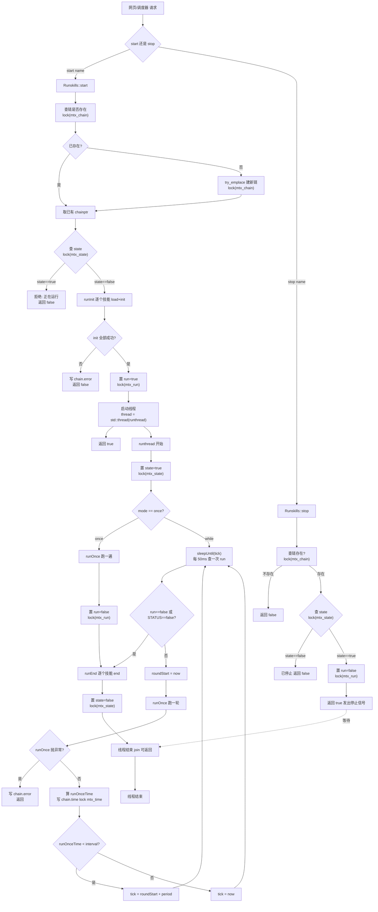
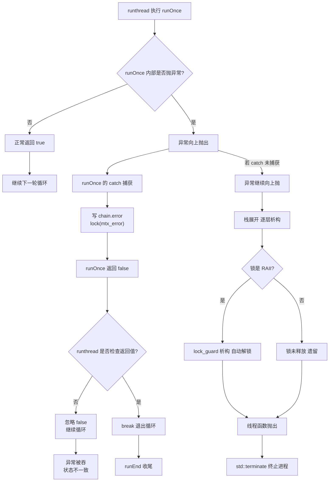

# 更新文档 - v1.0.1

---

## 发现上一个版本的问题

1. 鲁棒性不高，所有错误均抛出给主线程处理，导致所有的错误不论是小错误还是大错误都会使程序退出
2. skill逻辑问题，init()函数会在程序开始时统一调用，每一次停止不是卸载dll而是停止调用run()，不符合常理，应该skill链调用的时候统一init()然后进行run()
3. memory管理问题，插入注册函数会导致删除，每一次调用可能导致出现获取函数夹在删除和插入之中
4. Git库版本管理没有处理

---

## 当前已经处理

- [x] memory管理问题

- [x] skills链管理器

- [x] 异常抛出问题

- [x] Git库版本管理问题

---

## 处理问题方案

---

### memory处理

```cpp
template<typename T>
void Memory::insertOrAssign(const std::string& name, const T& value)
{
    std::lock_guard<std::mutex> lk(impl_->mtx_);
    impl_->content.insert_or_assign(name, std::any(value));
}
```

修改`insertOrAssign`函数处理逻辑，由于impl_.content是std::map处理，直接使用std::map.insert_or_assign进行覆盖处理

---

## skill链管理器更改方案

### 分析原因

由于v1.0.0代码中dll管理问题，对于opencv库需要绑定线程的用法，动态卸载dll和加载dll会出现问题，新的代码把dll管理和线程管理分开，在一开始就加载好dll动态库，然后在后续不加入新的dll，如果skill的dll有问题，需要重启程序，然后再每一次开始的时候运行init(),每一轮运行run(),以及结束后运行end()用来释放dll逻辑内存。

### 更改方案

重写runskillslist程序，新写runskills.hpp/cpp用来代替runskillslists.hpp/cpp程序，新的逻辑图如下所示

### skill管理图



---

## 异常抛出问题

### 问题分析

对于skill的抛出以前直接退出程序，导致运行失败

### 解决方案

先改链结构的异常抛出问题



---

## git库管理问题

当前已经上传源码到`https://github.com/RM-ZHUXI/SkillsContorl.git`,并且同步更新skill创建